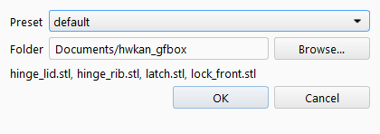
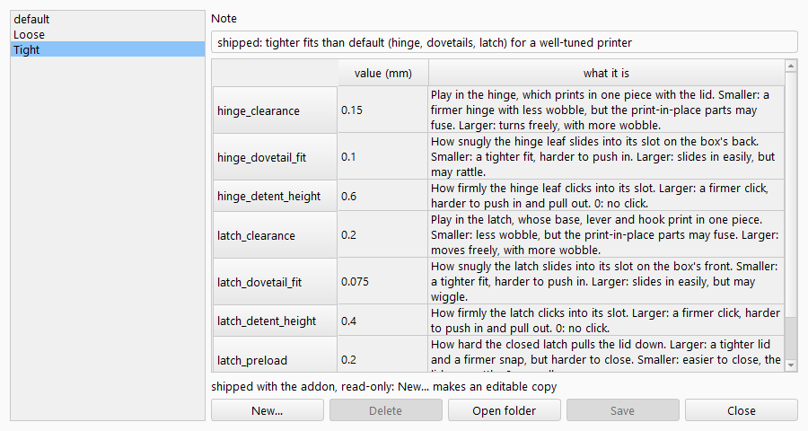
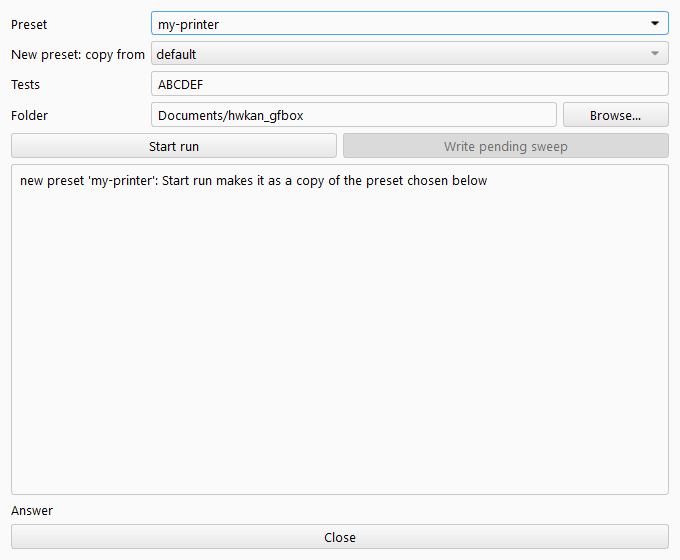
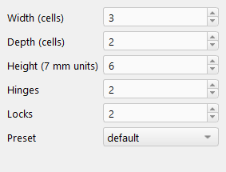

# Gridfinity Hinged Box

A storage box for Gridfinity bins, with a hinged lid and latches that
snap shut. The hinges and latches print in place, with no screws or glue.
This FreeCAD workbench makes the box in the size you need and tunes the fit to
your printer.

<!-- photo: a printed box, open and closed (see the image list) -->

You're probably here for one of two reasons:

- You want another size of box, or more hinges or locks. Go to
  [Build a box](#build-a-box).
- The ready-made files didn't fit. A hinge fused, or a part was too tight
  or too loose. Start with
  [Check the fit with test prints](#check-the-fit-with-test-prints).

## Install

You need [FreeCAD](https://www.freecad.org) 1.1 or newer.

1. In FreeCAD, open **Tools → Addon Manager**.
2. Click the gear (Preferences), go to **Custom repositories** and add
   `https://github.com/hwkanl/gridfinity-hinged-box` with branch `main`.
3. Find **Gridfinity Hinged Box** in the Addon Manager, install it and
   restart FreeCAD.
4. Pick **Gridfinity Hinged Box** in the workbench list.

You get this toolbar:

| Button | What it's for |
|---|---|
| New box | Make a box: size, hinges, locks and a preset |
| Edit box | Add your own details to a box, such as text on the lid |
| Export STLs | Save the files to print |
| Presets | See and change the fit settings for your printer |
| Calibrate | Find the right fit settings, one print at a time |
| Test prints | Print four small parts to check a preset |

### The panel doesn't show up

New box opens a panel on the side of the window. If nothing appears, the
panel may be hidden as an overlay. Try these in order:

1. **View → Overlay Docked Panel → Toggle Overlay for All Panels**.
2. Make sure **View → Panels → Tasks** is ticked.

## Check the fit with test prints

Every printer prints a little differently. A **preset** holds the
settings that depend on the printer, such as how much room the moving
parts get and how firmly they click into place. Three come with the workbench: `default`,
`Tight` and `Loose`. Before you print a whole box, print the test parts
for a preset and see if they fit.

### Print the test parts

Click **Test prints**, pick a preset and a folder, and click OK. Making
the parts takes a few seconds, and up to about 30 seconds on a slow
computer.

You get four small parts:

| File | What it is |
|---|---|
| `hinge_lid.stl` | A piece of the lid with a hinge, its leaf printed in place |
| `hinge_rib.stl` | The slot on the box's back that the leaf slides into |
| `latch.stl` | One latch, printed in one piece |
| `lock_front.stl` | The slot on the box's front for the latch, with the lid's edge on top |

Print them as they are, without supports.

### Try them

1. Swing the leaf on `hinge_lid` and slide it down into `hinge_rib` until
   it clicks.
2. Slide the latch up into `lock_front` from below until it clicks, then
   close it over the edge on top.

With a good fit, the hinge turns freely without wobbling, and the leaf
and the latch slide in by hand and click. The closed latch holds firmly
but still opens by hand.

### If something is off

Find what you see in the table. Each line names the setting to change and
which way. Change it by one step, then print that part again. A step is
0.025 mm for the clearances and the dovetail fits, and 0.05 mm for the
detent heights and `latch_preload`.

| What you see | Setting | Change |
|---|---|---|
| The hinge is stuck, or its parts fused | `hinge_clearance` | up |
| The hinge wobbles | `hinge_clearance` | down |
| The leaf won't slide into the slot | `hinge_dovetail_fit` | up |
| The leaf rattles in the slot | `hinge_dovetail_fit` | down |
| The leaf is very hard to click in or out | `hinge_detent_height` | down |
| The leaf doesn't stay in | `hinge_detent_height` | up |
| The latch's parts are stuck or fused | `latch_clearance` | up |
| The latch's parts wobble | `latch_clearance` | down |
| The latch won't slide into its slot | `latch_dovetail_fit` | up |
| The latch wiggles in its slot | `latch_dovetail_fit` | down |
| The latch is very hard to click in or out | `latch_detent_height` | down |
| The latch doesn't stay in | `latch_detent_height` | up |
| The latch is very hard to close | `latch_preload` | down |
| The closed lid is loose | `latch_preload` | up |

### Change a preset

You can't change the presets that come with the workbench, so make your
own copy:

1. Click **Presets** and select the preset closest to what you need.
2. Click **New…** and give your copy a name, such as your printer's.
3. Change the values, then click **Save**.

The column on the right says what each setting does. When you've saved,
make test prints with your preset and try again.

### Or let Calibrate find the values

If you'd rather not guess, **Calibrate** finds the settings for you, one
at a time. For each setting it makes a strip of the same part in five
slightly different sizes, each with a number on its underside. You print
the strip, try the parts, and click the number that fits best. If none
fit, click the word that says what was wrong, such as too tight or too
loose, and Calibrate makes a new strip. It saves your choices in the
preset you named.

1. Click **Calibrate**.
2. Type a name for your new preset and pick the preset to start from.
3. Pick a folder and click **Start run**.
4. Print the files it writes, try the parts, and click your answer under
   **Answer**. Repeat until it says it's done.

The dialog tells you what to print and how to judge each strip.
Calibrate does six of the settings in one run. The last one,
`latch_preload`, sets how hard the latch pulls the lid shut. To try it
you need the lid's edge and the box's front, so print a box with your new
preset, or just `lock_front.stl` from **Test prints**. Then open
Calibrate, pick your preset, type `G` in the **Tests** field and click
**Start run**.

## Build a box

Click **New box**. A panel opens on the side.

- **Width** and **Depth**: the number of Gridfinity cells, at least 2
  each. A cell is 42 mm. The width is the side with the hinges and locks, and
  it can't be smaller than the depth.
- **Height**: in Gridfinity units of 7 mm, at least 3.
- **Hinges** and **Locks**: how many, up to one per cell of width. A box
  needs at least 2 hinges and 1 lock.
- **Preset**: the fit settings for your printer.

Click OK. The box appears in the 3D view after a few seconds.

### Add your own details

With a box open, click **Edit box**. It makes a copy of the box that you
can change with FreeCAD's own tools, for example to put text on the lid.
The copy has one body per file to print, already laid out for printing.
This guide doesn't cover FreeCAD itself. When you're done, save the copy
under a name of your own, keep it the active document, and click
**Export STLs**. You get one file per body, named after the body.

## Export STLs

Click **Export STLs** and pick a folder. You get:

- the lid and the bottom, named after the size, such as lid_3x2x6.stl.
  The hinge leaves are part of the lid file.
- `latch.stl`. Print it once for each lock.
- `build_info.json`, which records what was built and with which
  settings. Keep it with the files, and include it if you ask for help.

The parts already lie the right way up for printing. Put them on the bed
as they are, with no supports.

## Print and put it together

1. **Hinges.** The leaves print attached to the back of the lid. Swing
   each leaf down past the lid's edge, toward the side that lay on the
   bed, until it hangs with its flat side toward the box. Then lower the
   lid onto the bottom, so the leaves slide into the slots on the back
   until they click.
2. **Latches.** Slide each latch up into its slot on the front from below
   until it clicks. Hook it over the edge of the lid and press the lever
   shut.

If the leaves are stuck to the lid at the bottom, your printer squishes
the first layer too much. This is called elephant's foot. Reduce it in
your slicer, or break the leaves free carefully.

## Reference

The panel's fields and the preset settings, with their values in
`default`:

| Name | Default | Meaning |
|---|---|---|
| `gf_x` | 3 | grid cells along X |
| `gf_y` | 2 | grid cells along Y |
| `gf_z_units` | 6 | bin height in 7 mm units (stacking lip not included) |
| `hinge_count` | 2 | number of hinges along the back wall (2 to gf_x, as many as fit) |
| `lock_count` | 2 | number of locks along the front wall (1 to gf_x, as many as fit) |
| `hinge_clearance` | 0.2 mm | Play in the hinge, which prints in one piece with the lid. Smaller: a firmer hinge with less wobble, but the print-in-place parts may fuse. Larger: turns freely, with more wobble. |
| `hinge_dovetail_fit` | 0.125 mm | How snugly the hinge leaf slides into its slot on the box's back. Smaller: a tighter fit, harder to push in. Larger: slides in easily, but may rattle. |
| `hinge_detent_height` | 0.6 mm | How firmly the hinge leaf clicks into its slot. Larger: a firmer click, harder to push in and pull out. 0: no click. |
| `latch_clearance` | 0.25 mm | Play in the latch, whose base, lever and hook print in one piece. Smaller: less wobble, but the print-in-place parts may fuse. Larger: moves freely, with more wobble. |
| `latch_dovetail_fit` | 0.1 mm | How snugly the latch slides into its slot on the box's front. Smaller: a tighter fit, harder to push in. Larger: slides in easily, but may wiggle. |
| `latch_detent_height` | 0.4 mm | How firmly the latch clicks into its slot. Larger: a firmer click, harder to push in and pull out. 0: no click. |
| `latch_preload` | 0.2 mm | How hard the closed latch pulls the lid down. Larger: a tighter lid and a firmer snap, but harder to close. Smaller: easier to close, the lid may rattle. 0: no pull. |

Your own presets are files in FreeCAD's user data folder, under
`hwkan_gfbox/presets/`: on Windows `%APPDATA%\FreeCAD\v1-1\`, on Linux
`~/.local/share/FreeCAD/v1-1/`. **Presets → Open folder** takes you there.

## For developers

[DEVELOPING.md](DEVELOPING.md) covers running the generator from the
command line and as FreeCAD macros, and its tests.

## Licence

Copyright (C) 2026 hwkan. Licensed under the GNU LGPL v2.1 or later; see LICENSE.
